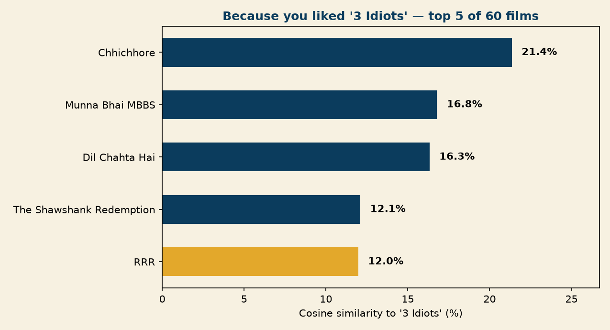

# Movie Recommender AI

[](https://mehtadeven.github.io/movie-recommender-ai/)    [](LICENSE) 

**▶ [Try the live demo](https://mehtadeven.github.io/movie-recommender-ai/)** — it runs in your browser, nothing to install.

A **content-based recommendation engine**: give it a film you like and it returns the five most similar titles from its catalogue — the same core mechanism behind the recommendation rows of major streaming platforms, implemented transparently in a few dozen lines.

## Who this helps

- **Students learning recommender systems** — the same TF-IDF + cosine similarity idea behind streaming recommendations, in a few dozen lines you can read and modify.
- **Movie fans** — pick a film you like and get five similar titles from a 60-film Indian and international catalogue, in the terminal or in the browser demo.
- **Teachers demoing similarity search** — similarity scores are printed, so a class can see *why* two films are considered close.
- **Portfolio builders** — a clean example of turning a CSV dataset into a working recommendation tool, with tests and a no-install web version.

## Sample output

```
Because you liked '3 Idiots':        Because you liked 'Interstellar':
  1. Chhichhore                        1. Avengers Endgame
  2. Munna Bhai MBBS                   2. Dune
  3. Dil Chahta Hai                    3. Mad Max: Fury Road
  4. The Shawshank Redemption          4. Inception
  5. RRR                               5. The Matrix

Because you liked 'Drishyam':
  1. A Wednesday
  2. The Godfather
  3. Pulp Fiction
  4. Shaitaan
  5. Gangs of Wasseypur
```

## Results



*Generated by `generate_charts.py`, which runs the real recommender: for "3 Idiots", Chhichhore is the closest match at 21.4% cosine similarity, followed by Munna Bhai MBBS (16.8%) and Dil Chahta Hai (16.3%). The catalogue now holds 60 films.*

## Demo


*Real run of `python recommend.py "3 Idiots"` — the five most similar films from the 60-film catalogue.*

## Try it in your browser (no install)

**Live: [mehtadeven.github.io/movie-recommender-ai](https://mehtadeven.github.io/movie-recommender-ai/)** — pick a film, filter by genre, choose how many picks. Every push to `main` redeploys it through [`.github/workflows/pages.yml`](.github/workflows/pages.yml).

The [`web/`](web/) folder is a standalone browser version of this recommender — plain HTML, CSS and JavaScript, no frameworks and nothing to install. It uses the same 60 films and the same TF-IDF + cosine similarity method, computed live in your browser, and gives the same top pick for "3 Idiots" (Chhichhore) as the Python version.

- **Easiest:** open [`web/index.html`](web/index.html) in any browser (double-click the file), pick a film, and read the recommendations.
- **Or serve it locally:**

```bash
cd web
python -m http.server
```

then visit `http://localhost:8000`.

The film data in `web/movies-data.js` is generated from `data/movies.csv` by `gen_web_data.py`, so the browser demo can never drift out of sync with the Python dataset — rerun `python gen_web_data.py` after editing the CSV.

## How it works


Each of the 60 films in `data/movies.csv` (Indian and international) carries hand-written genre and keyword tags. TF-IDF vectorises the tags; **cosine similarity** then measures the angle between any two films' vectors. The five smallest angles to your pick are the recommendations — no user data, no ratings matrix, purely content.

## Download & run (2 minutes)

**Step 1 — Download the code**

```bash
git clone https://github.com/mehtadeven/movie-recommender-ai.git
cd movie-recommender-ai
```

No Git? On the GitHub page for this repo, click the green **Code** button, choose **Download ZIP**, unzip it, and open that folder in a terminal.

**Step 2 — Install what it needs** (Python 3.10 or newer)

```bash
pip install -r requirements.txt
```

**Step 3 — Run it**

```bash
python recommend.py "3 Idiots"          # recommendations for one film
python recommend.py "Inception" --top 3   # only 3 recommendations
python recommend.py                     # demo picks: 3 Idiots, Interstellar, Drishyam
```

**Step 4 — What you should see**

You should see Chhichhore at number 1 for "3 Idiots" — exactly like the demo image above.

## Usage

```bash
python recommend.py                            # demo picks (3 Idiots, Interstellar, Drishyam)
python recommend.py "Inception"                # recommendations for one film
python recommend.py "Inception" --top 3        # only 3 recommendations (default: 5)
python recommend.py "3 Idiots" --genre Comedy  # only films of one genre
```

`--genre` matches against each film's genres in the dataset (for example
`Comedy`, `Thriller`, `Drama`, `Action`, `Sci-Fi`). Combine it with
`--top` to control how many filtered results you get:

```
$ python recommend.py "Drishyam" --genre Thriller

Because you liked 'Drishyam':
  1. A Wednesday
  2. Pulp Fiction
  3. Shaitaan
  4. Parasite
  5. Andhadhun
```

Call `recommend("Inception", df, similarity)` with any title in the dataset for your own list.

## Tests

```bash
pip install pytest
python -m pytest
```

The tests in `tests/` check that the dataset loads, that known picks such
as "3 Idiots" → Chhichhore come back, and that the `--top` and `--genre`
flags behave as documented.

## What this project demonstrates

- How production recommenders work at the concept level
- TF-IDF and cosine similarity as general text-comparison tools
- Why metadata quality drives recommendation quality

## Roadmap

- Scale the catalogue to 500+ films
- Add collaborative filtering (users who liked X also liked Y)
- Simple web UI

## Need help?

- **`pip` not found?** Use `python -m pip install -r requirements.txt` instead — it does the same thing.
- **Wrong folder error (file not found)?** Check your terminal is inside the repo folder — the prompt should end with the repo name, and `ls` (Mac/Linux) or `dir` (Windows) should list `README.md`.
- **Still stuck?** Open an Issue on this repo on GitHub with the command you ran and the full error message — that is the fastest way to get help.

## Contributing

Contributions are welcome — see [CONTRIBUTING.md](CONTRIBUTING.md) for
setup, how to run the tests, and how to add new films to the dataset.

## Licence

Released under the [MIT Licence](LICENSE).

---

**Author:** [Mehta Deven](https://github.com/mehtadeven) — IT student at SAL College of Engineering, Ahmedabad, building a public portfolio in Python, Machine Learning and AI.
**Portfolio:** [mehtadeven.github.io/portfolio](https://mehtadeven.github.io/portfolio/)

